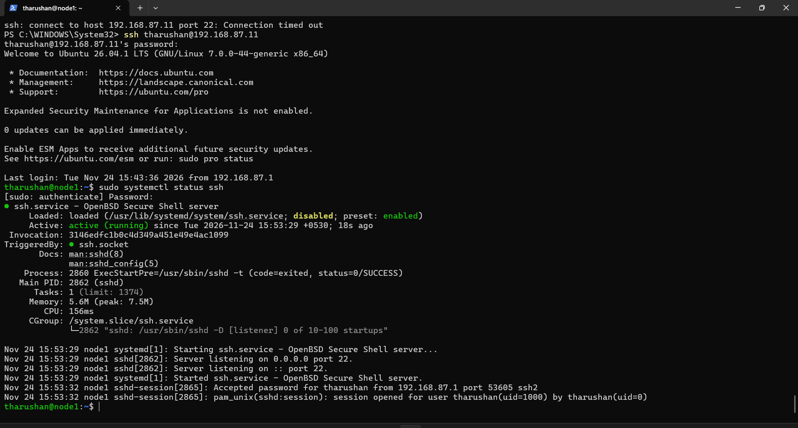
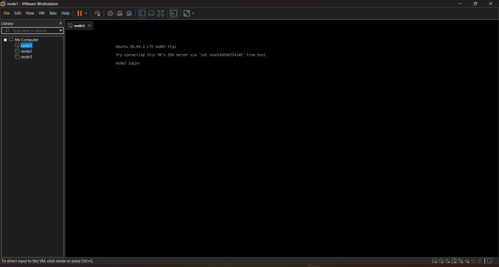
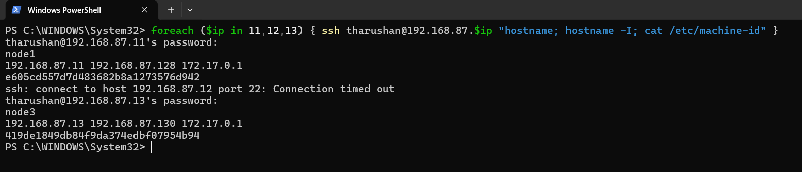
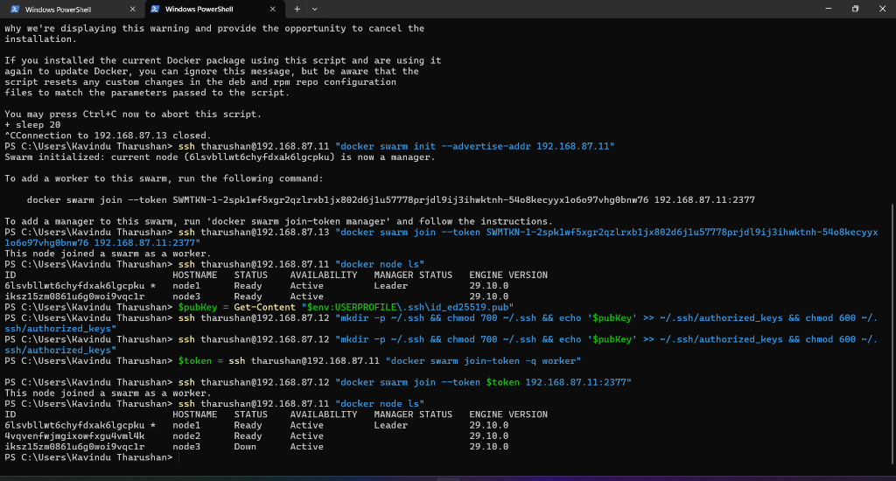
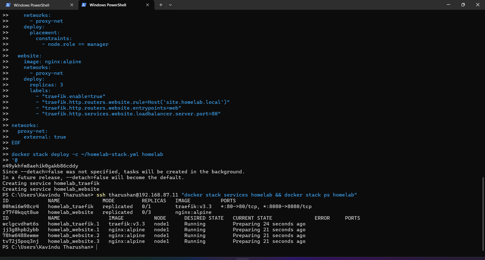
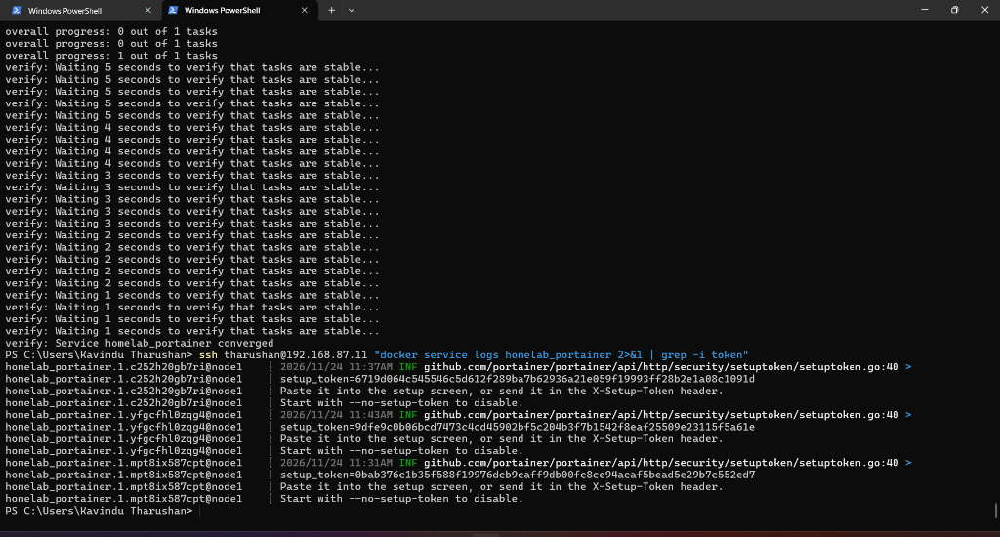
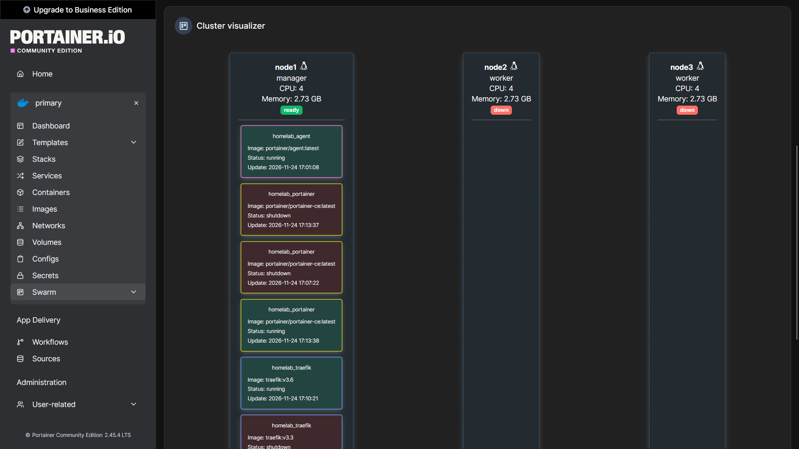
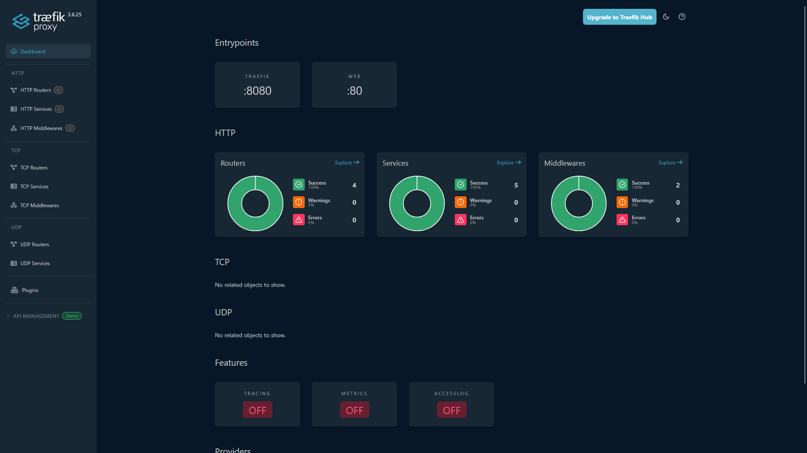

# 3-Node Docker Swarm Homelab (Traefik + Portainer)

A step-by-step documentation of building a 3-node Ubuntu 26.04.1 LTS Docker Swarm cluster on VMware Workstation, featuring passwordless SSH automation, Traefik v3 reverse proxy routing, and Portainer CE cluster management.

---

## Architecture & Network Topology

* **Hypervisor:** VMware Workstation on Windows
* **Operating System:** Ubuntu 26.04.1 LTS (`GNU/Linux 7.0.0-44-generic x86_64`)
* **Cluster Engine:** Docker Engine `29.10.0` (Swarm Mode)
* **Resources per Node:** 4 vCPUs / ~2.73 GB RAM
* **Subnet:** `192.168.87.0/24` (Gateway: `192.168.87.2` | DNS: `8.8.8.8`, `1.1.1.1`)

| Hostname | Swarm Role | Static IP | Machine ID |
| :--- | :--- | :--- | :--- |
| **`node1`** | Manager (Leader) | `192.168.87.11` | `e605cd557d7d483682b8a1273576d942` |
| **`node2`** | Worker | `192.168.87.12` | *(Regenerated post-clone)* |
| **`node3`** | Worker | `192.168.87.13` | `419de1849db84f9da374edbf07954b94` |

---

## Step-by-Step Build Process

### Phase 1: Base VM Setup & SSH Verification (`node1`)

1. Provisioned a clean Ubuntu 26.04.1 LTS virtual machine in VMware Workstation as `node1` (`192.168.87.11`) with user `tharushan`.
2. Verified SSH connectivity from Windows PowerShell and confirmed `ssh.service` was active and listening on port `22`.

```bash
sudo systemctl status ssh
```



---

### Phase 2: VM Cloning & Identity Separation (`node2` & `node3`)

1. Cloned `node1` inside VMware Workstation to create `node2` and `node3`.



2. Because cloned Linux VMs inherit identical `/etc/machine-id` hashes (which breaks DHCP and Docker Swarm node registration), each clone was re-initialized with a unique hostname, fresh `machine-id`, and static IP via `nmcli`:

```bash
# On node2 (repeat for node3 with 192.168.87.13)
sudo hostnamectl set-hostname node2
sudo rm /etc/machine-id && sudo systemd-machine-id-setup
sudo nmcli con mod "netplan-ens33" ipv4.addresses 192.168.87.12/24 ipv4.method manual ipv4.gateway 192.168.87.2 ipv4.dns "8.8.8.8 1.1.1.1"
sudo reboot
```

3. Cleared old host keys (`ssh-keygen -R`) and ran a PowerShell verification loop across `.11`, `.12`, and `.13` to confirm every node had a unique IP and `/etc/machine-id`.

```powershell
foreach ($ip in 11,12,13) { ssh tharushan@192.168.87.$ip "hostname; hostname -I; cat /etc/machine-id" }
```



---

### Phase 3: Passwordless SSH Keys & Docker Swarm Initialization

1. Generated an `ed25519` SSH key pair (`ssh-keygen -t ed25519`) on the Windows host and distributed `id_ed25519.pub` to `~/.ssh/authorized_keys` across all nodes:

```powershell
$pubKey = Get-Content "$env:USERPROFILE\.ssh\id_ed25519.pub"
foreach ($ip in 11,12,13) {
    ssh tharushan@192.168.87.$ip "mkdir -p ~/.ssh && chmod 700 ~/.ssh && echo '$pubKey' >> ~/.ssh/authorized_keys && chmod 600 ~/.ssh/authorized_keys"
}
```

2. Installed Docker Engine `29.10.0`, initialized the Swarm leader on `node1` (`192.168.87.11`), and joined `node2` and `node3` as workers:

```powershell
ssh tharushan@192.168.87.11 "docker swarm init --advertise-addr 192.168.87.11"
$token = ssh tharushan@192.168.87.11 "docker swarm join-token -q worker"
ssh tharushan@192.168.87.12 "docker swarm join --token $token 192.168.87.11:2377"
ssh tharushan@192.168.87.13 "docker swarm join --token $token 192.168.87.11:2377"
ssh tharushan@192.168.87.11 "docker node ls"
```



---

### Phase 4: Core Stack Deployment (Traefik & Nginx)

1. Created an external Swarm overlay network (`proxy-net`) and deployed `~/homelab-stack.yml` containing:
   * **Traefik (`homelab_traefik`):** Reverse proxy constrained to `node.role == manager`, exposing ports `80` (`web`) and `8080` (dashboard) with the Docker Swarm provider enabled.
   * **Nginx Sample App (`homelab_website`):** 3 replicas of `nginx:alpine` routed via Traefik rule ``Host(`site.homelab.local`)``.

```powershell
ssh tharushan@192.168.87.11 "docker stack deploy -c ~/homelab-stack.yml homelab"
ssh tharushan@192.168.87.11 "docker stack services homelab && docker stack ps homelab"
```



---

### Phase 5: Portainer CE & Traefik Dashboards

1. Deployed **Portainer CE (`v2.45.4 LTS`)** with the **Portainer Swarm Agent** (`tcp://tasks.agent:9001`) and retrieved the initial administrator `setup_token` from the service logs:

```powershell
ssh tharushan@192.168.87.11 "docker service logs homelab_portainer 2>&1 | grep -i token"
```



2. Connected the primary Swarm environment in Portainer and inspected node roles, resource allocation, and running services in the **Cluster Visualizer**:



3. Verified the upgraded **Traefik v3.6.25 Dashboard** (`http://192.168.87.11:8080`) showing active HTTP routers, services, and middlewares:


