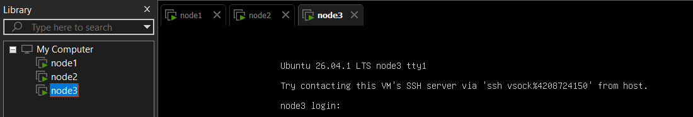
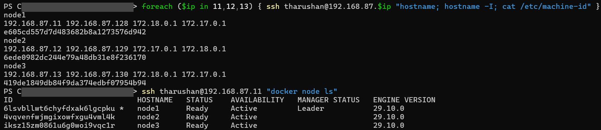
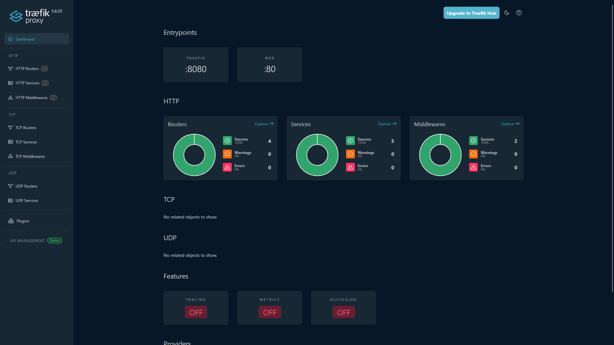
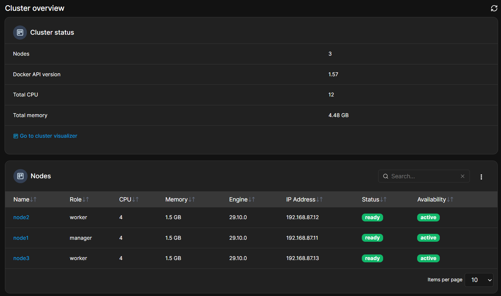
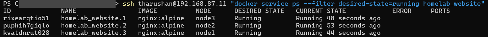
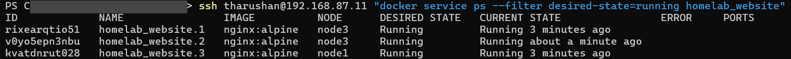

# 3-Node Docker Swarm Homelab (Traefik + Portainer)

A virtualized 3 node Docker Swarm cluster on one Windows PC, I built it in VMware Workstation. It runs Traefik as a reverse proxy, Portainer CE for cluster management, and a sample web service with one replica per node. I also tested failover by draining a node.

all nodes are virtual machines on a single host, so this lab shows Swarm, networking, and reverse proxy skills.

## Architecture

* **Hypervisor:** VMware Workstation on Windows
* **OS:** Ubuntu 26.04.1 LTS (`7.0.0-44-generic`), text-mode console
* **Container engine:** Docker Engine 29.10.0 (Swarm mode)
* **Per node:** 4 vCPUs and 1.5 GB RAM as reported by Docker (12 vCPUs and 4.48 GB across the cluster)
* **Network:** VMware NAT (VMnet8), subnet `192.168.87.0/24`, gateway `192.168.87.2`, DNS `1.1.1.1` and `8.8.8.8`

| Hostname | Swarm role | Static IP | Machine ID |
| :--- | :--- | :--- | :--- |
| `node1` | Manager (Leader) | `192.168.87.11` | `e605cd557d7d483682b8a1273576d942` |
| `node2` | Worker | `192.168.87.12` | `6ede0982dc244e79a48db31e8f236170` |
| `node3` | Worker | `192.168.87.13` | `419de1849db84f9da374edbf07954b94` |

### Services (stack `homelab`)

| Service             | Image                               | Purpose                                                                                            |
| :------------------ | :---------------------------------- | :------------------------------------------------------------------------------------------------- |
| `homelab_traefik`   | Traefik v3 (dashboard shows 3.6.25) | Reverse proxy on the manager node. Port `80` (`web`) and `8080` (dashboard), Docker Swarm provider |
| `homelab_website`   | `nginx:alpine`                      | Sample app, 3 replicas, routed by ``Host(`site.homelab.local`)``                                   |
| `homelab_portainer` | Portainer CE 2.45.4 LTS             | Cluster management UI                                                                              |
| `homelab_agent`     | Portainer agent                     | Gives Portainer a view of the whole Swarm (`tcp://tasks.agent:9001`)                               |

All services share an external overlay network called `proxy-net`.

## Repository contents

* `README.md` this file
* `homelab-stack.yml` the stack deployed with `docker stack deploy`
* `images/` screenshots used below

## Build steps

### 1. VMware network

The VMs use the default NAT network `VMnet8` (`192.168.87.0/24`). The IPs `.11` to `.13` are outside the DHCP range, so static addresses don't collide with leases.

### 2. Base VM (`node1`)

1. Installed Ubuntu 26.04.1 LTS in a new VM named `node1`, with OpenSSH server.
2. Set a static IP and hostname with NetworkManager. The connection is named `netplan-ens33` on this release:

```bash
sudo nmcli con mod "netplan-ens33" ipv4.method manual ipv4.addresses 192.168.87.11/24 ipv4.gateway 192.168.87.2 ipv4.dns "1.1.1.1 8.8.8.8"
sudo nmcli con up "netplan-ens33"
sudo hostnamectl set-hostname node1
```

3. Installed Docker Engine and added my user to the `docker` group:

```bash
curl -fsSL https://get.docker.com | sh
sudo usermod -aG docker $USER
```

4. Rebooted, confirmed `docker run hello-world` works without sudo, shut the VM down and took a snapshot (`node1-docker-ready`).

### 3. Clones (`node2`, `node3`)

Made two full clones of the snapshot. A clone starts with the same hostname, IP and machine ID as `node1`, so each one was fixed before the next was powered on:

```bash
# On node2 (node3 uses node3 and 192.168.87.13)
sudo hostnamectl set-hostname node2
sudo rm /etc/machine-id && sudo systemd-machine-id-setup
sudo nmcli con mod "netplan-ens33" ipv4.addresses 192.168.87.12/24
sudo reboot
```



Checked all three nodes from PowerShell. Each has its own IP and machine ID (the extra `192.168.87.12x` addresses are old DHCP leases, and `172.x` are Docker bridges):

```powershell
foreach ($ip in 11,12,13) { ssh tharushan@192.168.87.$ip "hostname; hostname -I; cat /etc/machine-id" }
```



### 4. Passwordless SSH

Generated an `ed25519` key on the Windows host and copied the public key to every node:

```powershell
ssh-keygen -t ed25519
$pubKey = Get-Content "$env:USERPROFILE\.ssh\id_ed25519.pub"
foreach ($ip in 11,12,13) {
    ssh tharushan@192.168.87.$ip "mkdir -p ~/.ssh && chmod 700 ~/.ssh && echo '$pubKey' >> ~/.ssh/authorized_keys && chmod 600 ~/.ssh/authorized_keys"
}
```

### 5. Swarm

`node1` initialises the swarm and the other two join as workers:

```powershell
ssh tharushan@192.168.87.11 "docker swarm init --advertise-addr 192.168.87.11"
$token = ssh tharushan@192.168.87.11 "docker swarm join-token -q worker"
ssh tharushan@192.168.87.12 "docker swarm join --token $token 192.168.87.11:2377"
ssh tharushan@192.168.87.13 "docker swarm join --token $token 192.168.87.11:2377"
ssh tharushan@192.168.87.11 "docker node ls"
```

The join token is a secret. I rotated it after building the lab (`docker swarm join-token --rotate worker`).

### 6. Traefik, website and Portainer

Created the overlay network and deployed the stack from `homelab-stack.yml`:

```powershell
ssh tharushan@192.168.87.11 "docker network create -d overlay proxy-net"
ssh tharushan@192.168.87.11 "docker stack deploy -c ~/homelab-stack.yml homelab"
ssh tharushan@192.168.87.11 "docker stack services homelab"
```

Traefik dashboard (`http://192.168.87.11:8080`) with its routers, services and middlewares:



Portainer sees all three nodes as ready and active:



## Verification

### Replica placement

`homelab_website` runs one replica on each node:

```powershell
ssh tharushan@192.168.87.11 "docker service ps --filter desired-state=running homelab_website"
```



### Failover test

Drained `node2` and checked where its replica went:

```powershell
ssh tharushan@192.168.87.11 "docker node update --availability drain node2"
ssh tharushan@192.168.87.11 "docker service ps --filter desired-state=running homelab_website"
```

Replica 2 moved from `node2` to `node3`, and the service stayed at 3 running replicas:



Then returned the node to service and redistributed the replicas. Swarm does not move running tasks back by itself:

```powershell
ssh tharushan@192.168.87.11 "docker node update --availability active node2"
ssh tharushan@192.168.87.11 "docker service update --force homelab_website"
```

sired-state=running` shows only the current ones.

## Next steps

* **One manager.** Promote `node2` and `node3` to managers (3-manager quorum) and run Traefik on every node.
* **HTTP only.** Next step: HTTPS with Let's Encrypt using a DNS challenge on a real domain.
* Disable SSH password login now that key login works, and add `ufw` rules for the Swarm ports.